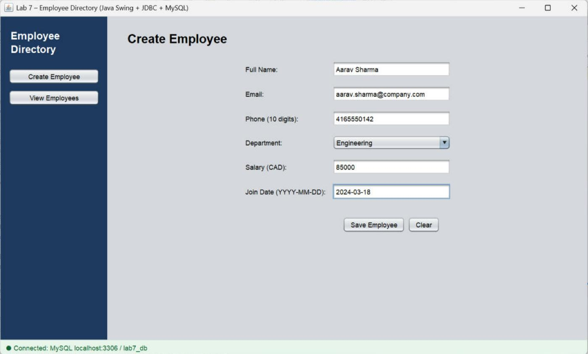
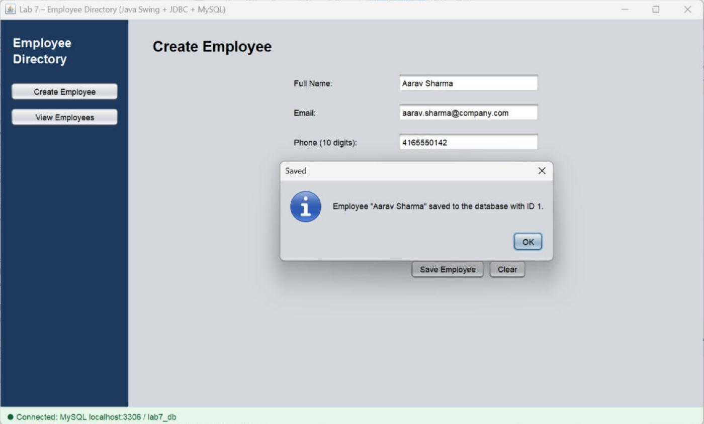
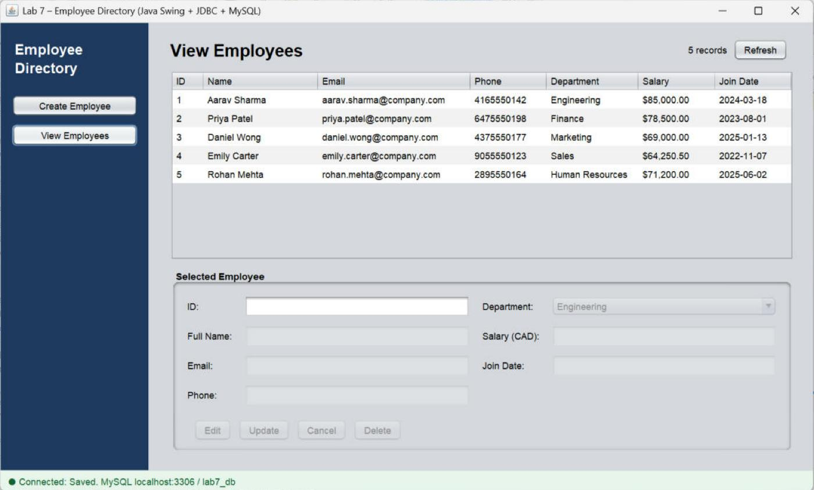
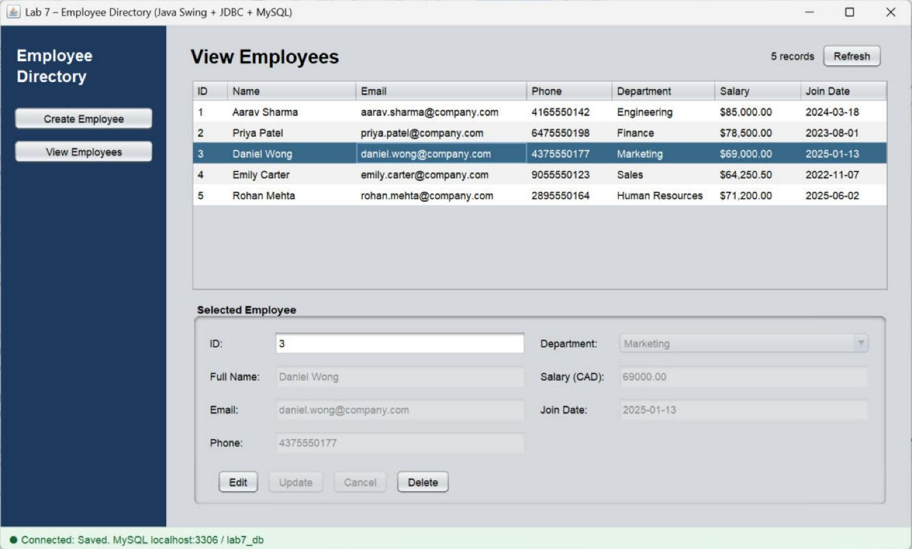
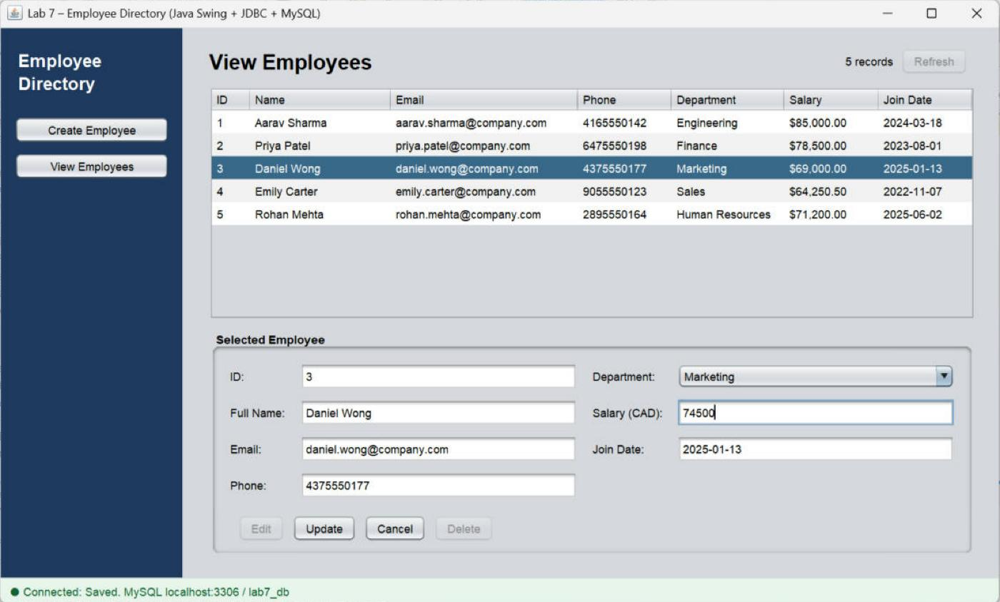
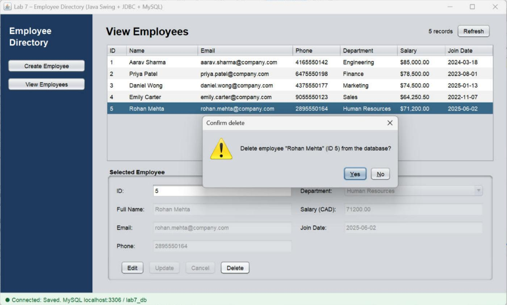
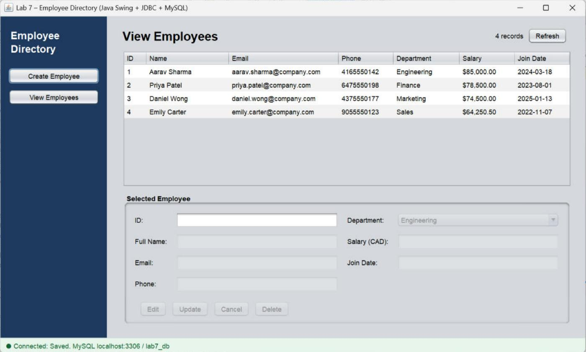
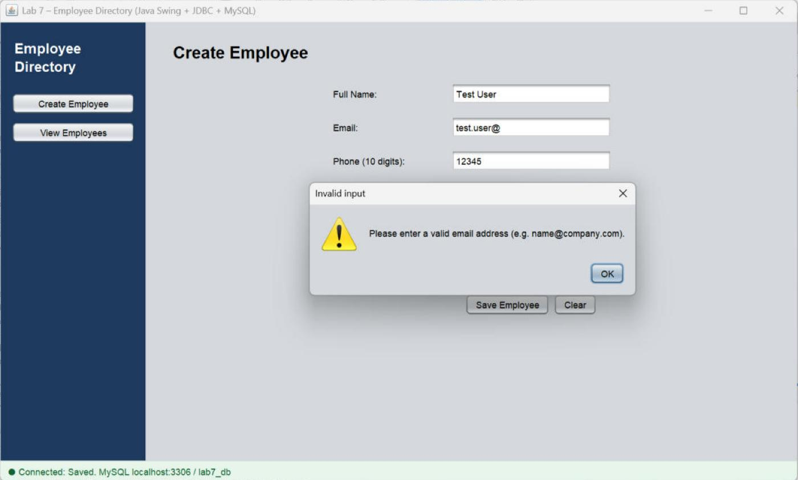
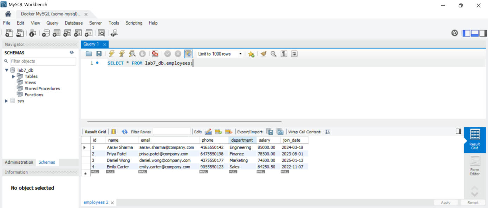

# Lab 7 – Database Connection with JDBC in Java Swing

**Employee Directory** is a Java Swing desktop app that stores and retrieves employees in a **MySQL** database through **JDBC** (MySQL Connector/J). It has two views, a **Create** form and a **View** screen with a **JTable**, and supports full CRUD.

| Operation | Where | JDBC call |
|---|---|---|
| **Create** | *Create Employee* form → **Save Employee** | `INSERT` (`DatabaseConnector.addEmployee`) |
| **Read** | *View Employees* → JTable is populated from MySQL | `SELECT` (`DatabaseConnector.getAllEmployees`) |
| **Update** | Select a row → **Edit** (fields enabled) → **Update** | `UPDATE` (`DatabaseConnector.updateEmployee`) |
| **Delete** | Select a row → **Delete** → confirm | `DELETE` (`DatabaseConnector.deleteEmployee`) |

Every statement is a `PreparedStatement`, and connections are closed with try-with-resources. Input is validated before anything reaches the database: name, email format, 10-digit phone, positive salary, and a join date that isn't in the future. The email column is `UNIQUE`, so a duplicate shows a friendly message instead of crashing.

## Screenshots

### 1. Create form: adding a new employee


### 2. Saved to MySQL


### 3. View screen: JTable populated from the database


### 4. Row selected → details shown (read-only)


### 5. Edit → fields enabled → Update saved to MySQL



### 6. Delete with confirmation



### 7. Validation


### 8. Data in MySQL (MySQL Workbench)


## Project structure

```
Lab7/
├── pom.xml                              Maven project (NetBeans-ready), mysql-connector-j dependency
├── database/DatabaseQueries.sql         Database, table and CRUD queries
├── screenshots/                         Application running
└── src/main/
    ├── resources/db.properties          JDBC connection settings
    └── java/com/lab7/
        ├── Main.java                    Entry point: creates DB/table if needed, opens the window
        ├── db/DatabaseConnector.java    All JDBC code (connect + CRUD)
        ├── model/Employee.java          Model class
        └── ui/
            ├── MainJFrame.java          Control panel (left) + work area with CardLayout (right)
            ├── FormJPanel.java          CREATE view
            ├── ViewJPanel.java          JTable + READ / UPDATE / DELETE view
            └── EmployeeValidator.java   Shared input validation
```

## How to run

1. Start MySQL. This lab uses the Lab 6 Docker container:
   ```
   docker run --name some-mysql -e MYSQL_ROOT_PASSWORD=my-secret-pw -p 3306:3306 -d mysql:latest
   ```
   (or `docker start some-mysql` if it already exists). To use another MySQL server, change `src/main/resources/db.properties`.
2. Open the folder in **NetBeans** (File → Open Project) and press **Run**. Maven downloads MySQL Connector/J automatically.
3. On start-up the app creates the `lab7_db` database and the `employees` table if they don't exist yet.

**Tech:** Java 17, Swing (JFrame, JPanel, JTable, CardLayout), JDBC, MySQL Connector/J 9.3.0, MySQL (Docker), Maven.
